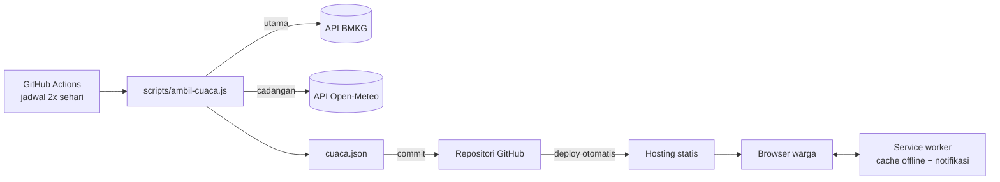

<div align="center">

# Info Desa Wirogomo

**Informasi cuaca, kontak darurat, dan pelaporan kejadian untuk warga Desa Wirogomo, Banyubiru, Kabupaten Semarang.**

Dirancang untuk sinyal lemah: ringan, bisa dibuka tanpa internet, dan mudah dipakai dari HP.


</div>

---

## Daftar isi

1. [Ringkasan](#ringkasan)
2. [Fitur](#fitur)
3. [Arsitektur](#arsitektur)
4. [Struktur proyek](#struktur-proyek)
5. [Memulai](#memulai)
6. [Konfigurasi](#konfigurasi)
7. [Deployment](#deployment)
8. [Pembaruan cuaca otomatis](#pembaruan-cuaca-otomatis)
9. [Notifikasi](#notifikasi)
10. [Pelaporan kejadian](#pelaporan-kejadian)
11. [Privasi dan keamanan](#privasi-dan-keamanan)
12. [Batasan](#batasan)
13. [Daftar cek peluncuran](#daftar-cek-peluncuran)
14. [Pemeliharaan](#pemeliharaan)
15. [Sumber data dan atribusi](#sumber-data-dan-atribusi)
16. [Kontributor dan lisensi](#kontributor-dan-lisensi)

## Ringkasan

Banyak wilayah pedesaan memiliki sinyal tidak stabil, sehingga aplikasi cuaca dan layanan informasi yang berat sulit dipakai. Proyek ini menyediakan satu halaman web kecil yang tetap berguna dalam kondisi tersebut: data cuaca terakhir tersimpan di perangkat, nomor darurat tersedia satu ketukan, dan laporan kejadian dapat dikirim lewat WhatsApp atau SMS dengan format yang seragam.

Proyek ini adalah situs statis (HTML, CSS, JavaScript) tanpa server, tanpa basis data, dan tanpa langkah build.

## Fitur

| Modul              | Deskripsi                                                                                                                                                       |
| ------------------ | --------------------------------------------------------------------------------------------------------------------------------------------------------------- |
| **Cuaca**          | Kondisi terkini dan prakiraan beberapa hari. Sumber utama BMKG, cadangan Open-Meteo. Menampilkan waktu pembaruan terakhir dan peringatan bila data kedaluwarsa. |
| **Notifikasi**     | Peringatan cuaca buruk dan ringkasan cuaca harian (lihat [batasan](#notifikasi)).                                                                               |
| **Kontak darurat** | 112, ambulans, pemadam kebakaran, polisi, Basarnas, BPBD, PLN, dan nomor desa. Panggilan satu ketukan.                                                          |
| **Lapor kejadian** | Formulir singkat dengan pratinjau pesan, lokasi GPS opsional, dan pengiriman ke penerima yang dipilih lewat WhatsApp atau SMS.                                  |
| **Offline**        | Service worker menyimpan halaman dan data cuaca terakhir agar tetap terbuka tanpa internet.                                                                     |
| **Aksesibilitas**  | Teks besar, kontras tinggi, dan area sentuh yang luas untuk pengguna lanjut usia.                                                                               |

## Arsitektur



Alur singkat: Actions mengambil data, menulis `cuaca.json`, dan meng-commit-nya. Hosting statis memuat ulang situs. Browser warga mengunduh `cuaca.json` dan menyimpannya untuk dipakai offline.

## Struktur proyek

```
.
├── index.html                  # halaman utama: tab, gaya, dan logika aplikasi
├── sw.js                       # service worker: cache offline, notifikasi latar belakang
├── notif.js                    # logika notifikasi (dipakai halaman dan sw.js)
├── cuaca.json                  # data cuaca; dihasilkan otomatis, jangan diedit manual
├── scripts/
│   └── ambil-cuaca.js          # mengambil data cuaca dan menulis cuaca.json
└── .github/
    └── workflows/
        └── cuaca.yml           # penjadwal pembaruan cuaca
```

## Memulai

### Prasyarat

- Node.js (versi LTS) untuk skrip pengambil cuaca dan server lokal
- Git
- Akun GitHub

### Menjalankan secara lokal

```bash
# 1. Ambil data cuaca terbaru
node scripts/ambil-cuaca.js

# 2. Jalankan server lokal tanpa cache
npx http-server -p 8000 -c-1
```

Buka `http://localhost:8000`.

> Service worker, notifikasi, dan GPS hanya berfungsi di `localhost` atau alamat HTTPS.

### Menguji di HP

Gunakan alamat HTTPS sementara, misalnya fitur **Ports** di VS Code atau `cloudflared tunnel --url http://localhost:8000`. Alamat sementara terbuka untuk siapa saja yang memilikinya, jadi tutup setelah selesai.

## Konfigurasi

Pengaturan berada di bagian atas tag `<script>` pada `index.html`.

| Parameter          | Fungsi                                                                                             |
| ------------------ | -------------------------------------------------------------------------------------------------- |
| `NAMA_DESA`        | Nama desa pada pesan laporan                                                                       |
| `PENERIMA_WA.desa` | Nomor WhatsApp piket atau Kepala Desa (format `62...`, tanpa `+`). Tombol tersembunyi sampai diisi |
| `PENERIMA_WA.bpbd` | Nomor WhatsApp BPBD                                                                                |
| `NOMOR_SMS`        | Nomor tujuan SMS. Kosongkan untuk menyembunyikan tombol                                            |
| `NOMOR_TELP`       | Nomor tombol telepon darurat (default `112`)                                                       |
| `ENDPOINT`         | URL penampung laporan, opsional (mengaktifkan antrean offline)                                     |
| `KONTAK`           | Daftar kontak pada tab Kontak                                                                      |

Pengaturan sumber data cuaca berada di `scripts/ambil-cuaca.js`:

| Parameter    | Fungsi                                     |
| ------------ | ------------------------------------------ |
| `ADM4`       | Kode wilayah BMKG tingkat desa             |
| `LAT`, `LON` | Koordinat untuk sumber cadangan Open-Meteo |

Nomor versi yang tampil di aplikasi ditulis pada `index.html` (teks `Versi 1.0`).

## Deployment

Situs ini dapat dipasang di hosting statis gratis mana pun, misalnya GitHub Pages, Cloudflare Pages, atau Netlify.

Ketentuan umum:

- Hubungkan repositori GitHub ke penyedia hosting
- Kosongkan _build command_
- Arahkan folder publikasi ke akar repositori
- Gunakan alamat HTTPS (wajib untuk notifikasi dan service worker)

Setiap commit `cuaca.json` memicu satu deploy. Dengan jadwal dua kali sehari, jumlahnya sekitar 60 deploy per bulan. Periksa batas paket gratis penyedia hosting yang dipilih.

Beberapa paket gratis menampilkan lencana atau elemen penyedia pada situs. Pengaturannya biasanya dapat diubah di dasbor penyedia.

## Pembaruan cuaca otomatis

Workflow `.github/workflows/cuaca.yml` menjalankan `scripts/ambil-cuaca.js` pada sekitar **05.07 WIB** dan **17.07 WIB**, lalu meng-commit `cuaca.json` bila ada perubahan. Workflow juga berjalan ketika `ambil-cuaca.js` atau `cuaca.yml` diubah, dan dapat dijalankan manual lewat **Actions → Perbarui cuaca → Run workflow**.

**Urutan sumber data**

1. BMKG (utama)
2. Open-Meteo (cadangan bila BMKG tidak dapat diakses)

Halaman mencantumkan sumber yang dipakai. Data Open-Meteo diberi label sebagai model prakiraan global, bukan BMKG.

**Prasyarat repositori**

- _Settings → Actions → General → Workflow permissions_ diatur ke **Read and write permissions**

**Catatan operasional**

- Jadwal GitHub dapat tertunda beberapa menit hingga puluhan menit.
- Pada repositori publik, GitHub menonaktifkan jadwal otomatis jika tidak ada aktivitas selama 60 hari. Aktifkan kembali dari tab Actions bila perlu.
- Bot menambahkan commit di GitHub, sehingga lakukan _pull_ sebelum mengedit berkas secara lokal.
- Halaman menampilkan peringatan bila data lebih tua dari 26 jam.

## Notifikasi

Dua jenis notifikasi tersedia setelah pengguna menekan **Aktifkan notifikasi cuaca**:

- **Peringatan cuaca buruk:** muncul bila dalam 12 jam ke depan diprakirakan hujan lebat, petir, atau angin 30 km/jam atau lebih.
- **Ringkasan harian:** muncul sekali sehari, mulai pukul 06.00 WIB.

**Batasan teknis**

- Notifikasi muncul saat web dibuka. Pada Chrome/Edge Android dengan web yang sudah ditambahkan ke layar utama, sinkronisasi latar belakang (_periodic sync_) dapat berjalan, tetapi waktunya ditentukan browser dan tidak dijamin.
- iPhone tidak mendukung sinkronisasi latar belakang tersebut.
- Notifikasi andal saat web tertutup membutuhkan server _push_, yang tidak termasuk dalam arsitektur statis ini. Alternatif: kirim peringatan ke channel Telegram atau grup WhatsApp desa melalui GitHub Actions.

## Pelaporan kejadian

Formulir menghasilkan pesan terstruktur berisi jenis kejadian, tingkat urgensi, korban, lokasi, tautan peta (bila GPS diizinkan), catatan, dan waktu. Pengguna memilih penerima:

- **Perangkat Desa** (WhatsApp)
- **BPBD** (WhatsApp)
- **BPBD** (SMS)

Tombol membuka aplikasi tujuan dengan pesan terisi; pengguna harus menekan kirim sendiri. Nomor pengirim ikut terlihat oleh penerima. Untuk kondisi bahaya yang sedang berlangsung, formulir mengarahkan pengguna untuk menelepon 112 terlebih dahulu.

## Privasi dan keamanan

- Proyek ini tidak menyertakan skrip analitik atau pelacak.
- Lokasi GPS hanya diminta saat pengguna menekan tombol lokasi, dan hanya disertakan dalam pesan yang pengguna kirim sendiri.
- Penyimpanan lokal browser dipakai untuk cache offline, status notifikasi, dan (bila `ENDPOINT` diaktifkan) antrean laporan.
- Isi laporan yang dikirim lewat WhatsApp atau SMS tunduk pada kebijakan masing-masing layanan.
- Penyedia hosting dapat mencatat akses sesuai kebijakan mereka.
- Jangan menyimpan token, kata sandi, atau data pribadi di repositori. Proyek ini tidak membutuhkannya.

## Batasan

- Prakiraan cuaca **bukan peringatan dini resmi**. Untuk peringatan dini, rujuk BMKG.
- Pembaruan cuaca dua kali sehari, sehingga perubahan mendadak dapat terlambat terlihat.
- Aplikasi ini melengkapi, bukan menggantikan, panggilan ke layanan darurat.

## Pemeliharaan

- Setelah mengubah `index.html`, naikkan nama cache pada `sw.js` (`info-desa-v6` menjadi `v7`, dan seterusnya) agar pengguna lama mendapat versi baru.
- Setelah deploy, muat ulang halaman dua kali untuk mengaktifkan service worker baru.
- Pantau tab Actions secara berkala untuk memastikan pembaruan cuaca berjalan.
- Perbarui nomor kontak bila ada pergantian pengurus.

## Sumber data dan atribusi

- **BMKG** — prakiraan cuaca tingkat desa melalui API publik BMKG.
- **Open-Meteo** — sumber cadangan. Periksa ketentuan penggunaan dan atribusinya di [open-meteo.com](https://open-meteo.com).

## Kontributor dan lisensi

- **Pengembang:** Brilliance AR
- **Mitra desa:** Pemerintah Desa Wirogomo, Kecamatan Banyubiru, Kabupaten Semarang
- **Lisensi:** [MIT](LICENSE)

Masukan dan laporan masalah dapat disampaikan melalui tab **Issues** di repositori ini.
